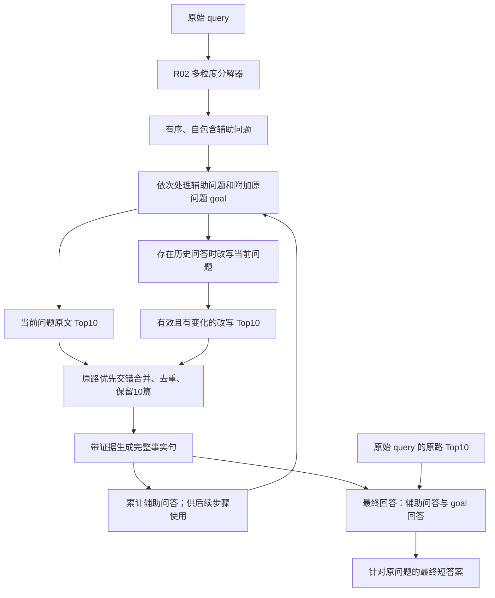

# P02 的想法、冻结实现与统一层接入

## 目标与当前证据

P02 希望把复杂问题拆成可以独立检索的辅助问题，用已获得的问答帮助后续问题显式化实体，再把分步事实和原问题的直接证据共同交给最终回答器。它允许中间回答比最终答案更完整，以保留供后续推理使用的关系信息。

这是设计意图。已有开发集Answer-F1不能单独证明机制的必要性、事实纠错能力或幻觉降低；相关简化实验已保留，正式机制消融目前搁置。

方法标识：`p02_multigrain_timing_cachefix_v1`。冻结核心见 [pipeline.py](../../src/p02_multigrain_timing_cachefix_v1/core/pipeline.py)，完整prompt见其相邻模块和 `prompts/`。这是独立包，核心无需依赖祖先实验目录。新统一层执行变体另标 `p02_shared_baseline_v2`，不覆盖旧包。

## 实际执行顺序

1. **只用问题文本进行分解。** 外部分解器为Qwen3-4B谱系的R02检查点，采用冻结v12提示词，产生有序的 `supporting_questions`。辅助问题应自包含，不用 `#N` 引用前面答案。检查点与训练来源见 [DECOMPOSER_IDENTITY.json](../../src/p02_multigrain_timing_cachefix_v1/models/DECOMPOSER_IDENTITY.json)。正式1500题已生成分解输出；分解器权重不在Git中。
2. **附加原问题作为goal。** 辅助问题之后再处理原始query。当前采用的 `timing_only` 简化把原问题Top10的获取推迟到goal阶段；它没有取消goal、子问答或最终回答，也不能据此宣称减少一次物理全索引搜索。
3. **对当前问题获取原路Top10。** 共同检索器为冻结BGE-small-en-v1.5，数据集各有冻结语料和索引。若已有历史问答，则按冻结c02方式改写当前问题；改写有效且不同于原文时，追加改写路Top10。原路优先交错合并、去重，reader最终看10篇。P02没有重排步骤。
4. **生成事实型中间回答。** 普通子问题使用冻结child示例与完整事实句要求；goal采用其冻结的零示例/一致性指令。历史问答用于后续改写与回答。当前P02不是C08版本，不擅自加入其全弃答过滤等机制。中间答案少于4个词时，额外请求将候选答案表达为有主体和关系的完整事实句；原生阶段输出上限等以源码为准。
5. **最终独立回答。** 将辅助问答和goal问答作为辅助材料，配合原始query的**原路Top10**，生成最终短答案。最终上下文不是改写路结果的全局并集，也不是把最后一个中间答案直接作为最终答案。最终readout保留问题所需实体/限定，Yes/No使用约定形式。
6. **缓存按完整请求身份复用。** canonical P02成功记录优先；历史相同完整payload可复用。缓存修复是执行基础设施修复，不按答案得分选择回执。失败、未知回执和被截断输出在新协议中不能冒充成功缓存；上游改变后受影响下游必须重新核验。

一条真实记录的完整展开见 [full_walkthrough.txt](evidence/outputs/query_decomposition/p02_query_walkthrough_20261020/full_walkthrough.txt)，其中保存分解、改写、检索、各阶段prompt、回答与回执。该例仅作流程说明；评估证据需看完整题集。

## 为什么使用统一基础层，以及保留什么

当前旧P02有原生rewrite256 / child128 / final64上限，旧final允许 `length` 的历史例外；旧检索也可能截断超长BGE输入。基线完整修复v2处理这些问题的协议不同，因此旧结果不能直接当成新统一层结果。

已批准的新适配见 [p02_shared_layer.py](../../experiments/query_decomposition/unified_rag_eval_v1_20261021/p02_shared_layer.py) 和 [INTEGRATION.txt](../../experiments/query_decomposition/unified_rag_eval_v1_20261021/INTEGRATION.txt)：

| 方面 | 接入方式与比较边界 |
| --- | --- |
| 请求身份和来源 | 复用OriginSafeTransport，绑定原始题与阶段，保留模型、完整消息及来源 |
| 长输入 | 复用v2完整窗口编码与输入检查，避免静默丢掉后半段 |
| 输出完整性 | 新请求沿用v2的32768输出允许量与上下文检查；传播和计分须完整结束且有usage |
| 方法自身结构 | 保留分解、原prompt/示例、goal、双路合并、中间回答和最终短答；不额外给P02加入reranker |
| 方法资源额度 | 主评不强制相同轮数或总检索预算；各方法保留自己的停止规则并记录实际tokens/费用 |
| 旧结果 | 保留旧协议身份；严格核验同题、同阶段、同完整消息及检索完整性后才允许迁移 |

统一层提供共同输入完整性与请求协议。它会改变原生输出允许量，因此属于明确标注的共同资源适配，不能声称与原论文全部设置相同，也不能默认所有历史成绩不变。适配器已有离线接口实现；完整执行器、全部论文参数映射和远端资源核验尚未完成。

## 来源与结论边界

分解器的开发/留出评审衡量分解F/S/C/U质量，不是下游Answer-F1。其训练来源、数据曝光与正式问题文本重合事实在现有审计中保留（已知7题：HotpotQA3、2Wiki2、MuSiQue2），当前没有追加排除、换题或重训实验。本分支不把这些固定官方开发/验证子集称为隐藏测试或完全未见数据。

冻结独立包的300题与正式1500题身份分开；代码可回放、分解已完成、完整RAG已完成和新统一层成绩已产生是四种不同状态。
