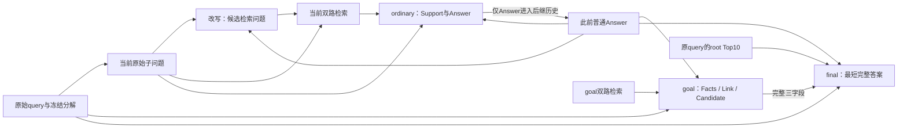

# P02首代协同提示词：r03设计说明

本稿的目标是：继续使用冻结R02/v12描述式分解，让后续阶段更可靠地理解关系、传递必要事实并回答原题。它没有已测F1；完整模板及24个虚构few-shot见revisions/r03/FULL_PROMPTS.en.md，逐项中文对照见同目录FULL_PROMPTS.zh.md。

## 从既有实验保留什么

现有证据不支持“描述式输入配上描述式说明就自然更好”。原#N示例除了表面格式，还演示了实体怎样从前一步进入下一步；展开描述以后，这一依赖需要回答器重新识别。已有刘娥配偶之父、Richard亲属深度等案例确实显示绑定错误，但普通节点的补充样本并未证明它是普遍主因。共同90题的显式操作/结果绑定、共享长历史，以及60题的通用充分性/信息保留提醒，都没有提供稳定总收益。

因此，新稿保留明确的跨步传递示范，仍让实际输入保持冻结分解器的描述式问题。不会把#字符认定为关键机制，也不把四个英文标签当作新方法贡献。待检验的假设是：一致的输入输出约定、相关的操作示例和可纠错的下游使用方式，组合起来可能优于逐个追加通用提醒。

## 四个阶段怎样交接

| 阶段 | 具体任务 | 提供给后继的信息 | 不能误当成什么 |
|---|---|---|---|
| rewrite | 在实体与关系相符时，将描述绑定为可检索实体；保留仍要求求解的关系 | 一条检索问题 | 原始任务或已核验答案 |
| ordinary | 回答原始当前子问题，保留实体、关系、属性与必要条件 | Answer完整事实句；Support仅保留在原始记录 | 自动修复分解，或提前替原题下结论 |
| goal | 用已有QA和新检索事实解决原题；显式写出必要的组合或缺口 | Facts、Link、Candidate三段完整文本 | 已验证证据或必须服从的最终答案 |
| final | 核对原题所问对象和条件，从原有root材料与候选信息给最短完整回答 | 最终短答案 | 只复制Candidate，或按参考答案清洗措辞 |

原有分解顺序、双路检索、合并Top10和final root材料选择均不变。阶段上下文独立，只传紧凑普通Answer与goal综合文本，不累积每轮完整对话。没有普通子问题的有效路线仍能直接运行goal。

图中的循环表示按冻结顺序处理下一子问题；没有额外重复求解或验证调用。Support完整保存在本轮记录，但不沿历史边传递。

## 与旧P02的实质差异

新稿不只替换一句指令。它增加了ordinary/goal可见的实际检索措辞，增加普通Support输出与解析，替换goal输出形式和final展示，并将旧的短答LLM formatter排除在候选路径之外。这些差异全部保留在接口文档；不能把未来联合收益全部归于few-shot、CoT或符号。

检索措辞作为显式辅助上下文的动机，是让自包含描述与已绑定实体同时可见，但仍以原始当前问题为准。它也可能强化错误改写，这一点尚未解决，必须用错改写样本反测。Support的动机是促使局部关系保持完整；它可能写错解释，也可能增加输出成本。只有Answer进入后继历史，避免解释增长直接改变所有后续输入。

goal输出的“Facts”是字段名称，不是事实核验认证。它允许保留goal新取得、root中没有的事实，同时要求说明真正必要的连接。final既不能因root未重复这些事实而全盘丢弃，也不能因它们出现在Facts里就无条件相信。当前架构没有独立验证器，这个信息可信度边界依然存在。

## 示例的构成与取舍

rewrite 4例、ordinary 6例、goal 8例、final 6例，共24例。它们使用虚构名字和事实；没有把诊断集原题或答案塞进示例。

- 跨步实体绑定：先配偶、再父亲、再出生地，并明确与本人的父亲区分。
- 属性对齐：座位数不能替换成总容量；导演不能替换成制片人。
- 信息充分性：部分列表可提供真条目，不能直接代表总数；但至少四个已经足以超过确切三个。
- 替代路径：缺精确经度不妨碍用足够明确的相对位置比较；一个否定已能否定“两个都成立”。
- 原题条件：保留多个符合要求的职位，不额外添加“最高级别”；最终问电影时不能返回中间导演。
- 错误可纠正：few-shot中的错误历史或错误Candidate只作为输入，输出演示怎样纠正；不把错误链当作正确goal示例。

并未把40个检查案例全部写进few-shot。否则上下文会变得冗长，示例分布也会被少数已知失误主导。140词等均是软目标，实际完整结束由响应状态检查，不由客户端裁剪实现。当前英文静态指令加示例的空白分词量约为321/957/1376/884；这不是模型token数，更不是已测费用。

## 仍需通过实验回答的问题

1. 新增检索措辞能帮助绑定，还是更常把回答器带向错误实体？
2. Support是否修复必要事实，还是仅扩写说明、制造新错误或更常弃答？
3. Answer压缩是否保留下一步所需条件？事实正确而信息不足的答案仍可能切断求解。
4. goal能否执行示例中的组合规则，尤其是已有事实足够却偏离所问、增加筛选条件的问题？
5. final能否利用完整综合文本，同时避免被错误Link/Candidate锚定？
6. 任何F1变化中，有多少是真实实体/关系修复，有多少是称谓、标点、粒度或冗余词变化？

这些问题没有因为离线接口检查通过而得到答案。对于候选检索未覆盖或合并Top10已删除的证据，提示词也不能凭空恢复；应继续与检索改动分开研究。

具体后续比较见VALIDATION_PLAN.md；本次没有执行其中的模型实验，也没有替换主评估计划。
